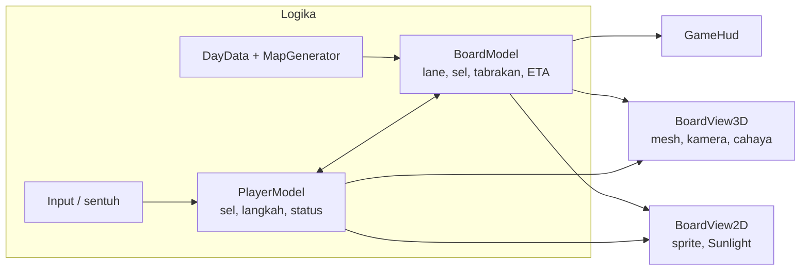
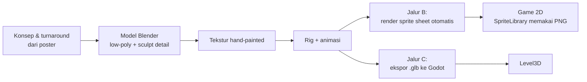
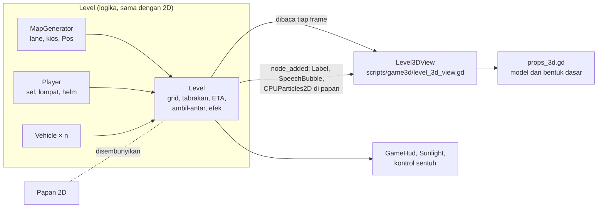

# Konsep 3D Si Ngacir

Dokumen ini menimbang langkah setelah gaya **2D painted-lite** (v0.9): apakah, kapan, dan bagaimana Si Ngacir naik ke tampilan 3D yang mendekati poster key art. Isinya pertimbangan, skema teknis, konsep visual, anggaran aset, dan tahapan kerja. Semua angka adalah **perkiraan awal** yang harus diukur ulang lewat prototipe.

> **Status (v0.11):** varian **Tampilan 3D (beta)** sudah bisa dimainkan di browser (itch), Windows, dan Android lewat **Pengaturan → Tampilan 3D**. Skema, skenario, dan rencana pengembangannya ada di [bagian 11](#11-varian-3d-beta-skema-skenario-dan-pengembangan).

## 1. Kondisi sekarang

| Aspek | Nilai saat ini |
| --- | --- |
| Engine | Godot 4.3, renderer **Compatibility** (OpenGL ES 3 / WebGL 2) |
| Gameplay | Grid 15 kolom × 48 px, kamera dari atas, kendaraan per lane |
| Grafis | Sprite SVG flat-kawaii + shading gradasi, filter cahaya `Sunlight` |
| Build web | Template ramping **tanpa 3D**: wasm ±29 MB (gzip ±6,7 MB), pck ±1,9 MB |
| Target | Browser desktop, HP kelas menengah (web dan APK), Windows |

Gameplay ala Frogger menuntut **keterbacaan**: pemain harus selalu bisa melihat jarak ke kendaraan. Itu batas utama setiap keputusan visual di bawah.

## 2. Pertimbangan

| Pertimbangan | 2D sekarang | Dampak bila ke 3D real-time |
| --- | --- | --- |
| Ukuran unduhan web | Kecil | Modul 3D harus diaktifkan lagi di template web: wasm naik beberapa MB, ditambah model dan tekstur |
| Performa HP | Ringan | Butuh anggaran poligon, draw call, dan bayangan yang ketat; uji di HP acuan wajib |
| Produksi aset | Generator SVG + Illustrator | Butuh modeler, rigger, dan animator 3D; aset jauh lebih mahal per karakter |
| Keterbacaan | Sangat jelas (tampak atas) | Kamera miring bisa menutupi lane di belakang kendaraan tinggi (truk) |
| Konsistensi gaya | Sudah seragam | Semua aset harus naik bersamaan; campuran 2D/3D terlihat setengah jadi |
| Aksesibilitas | Opsi teks, warna, gerak | Tetap wajib: mode tanpa efek cahaya, kurangi gerak kamera |
| Risiko jadwal | Rendah | Tinggi untuk proyek mata kuliah; harus bertahap dan bisa dibatalkan |

## 3. Tiga jalur

| | A. 2D painted (v0.9) | B. 2.5D pre-render | C. 3D real-time |
| --- | --- | --- | --- |
| Cara | Sprite 2D dengan shading, filter cahaya | Model 3D di Blender, **dirender jadi sprite sheet**; game tetap 2D | Model 3D langsung di Godot, kamera 3D |
| Kesan poster | ±60% | ±75% (cahaya dan volume konsisten) | ±85–90% |
| Ukuran web | Tidak berubah | Naik sedikit (PNG sprite) | Naik signifikan |
| Performa | Ringan | Ringan | Sedang–berat |
| Upaya | Selesai | Sedang: 1 model per karakter, render otomatis | Tinggi: model, rig, animasi, level 3D, shader |
| Kode game | Tetap | Tetap (`SpriteLibrary` sudah memprioritaskan PNG) | Lapisan tampilan baru (lihat skema) |

**Rekomendasi:** jalur **B dulu**, lalu putuskan C berdasarkan hasil prototipe. Model 3D yang dibuat untuk B (Masbro, kendaraan) bisa dipakai lagi di C, jadi tidak ada kerja yang terbuang.

## 4. Skema teknis

### 4.1 Pisahkan logika dari tampilan

Saat ini `Level` mengurus logika (grid, tabrakan, timer) sekaligus menggambar papan. Untuk 3D, logika dipisah supaya tampilan 2D dan 3D memakai aturan yang sama persis.



* `BoardModel` dan `PlayerModel` bekerja dalam **satuan sel**, bukan piksel.
* Tampilan 2D dan 3D hanya membaca keadaan model dan memutar animasi.
* Tes otomatis yang sekarang (tabrakan, ETA, rakit, pos) dipindah ke model, jadi berlaku untuk kedua tampilan.

### 4.2 Pemetaan koordinat

| 2D sekarang | 3D |
| --- | --- |
| 1 sel = 48 px | 1 sel = 1 m |
| Kolom → x | x (kiri–kanan) |
| Baris → y (turun) | z (menjauh dari kamera = maju) |
| Kecepatan px/detik | Sama, dibagi 48 → m/detik |
| `TILE` di level | Konstanta skala di `BoardView3D` |

### 4.3 Susunan scene 3D

```text
Level3D (Node3D)
├── WorldEnvironment        langit gradasi, ambient hangat
├── Sun (DirectionalLight3D) dari kanan atas, sesuai filter Sunlight
├── CameraRig (Node3D)       mengikuti Masbro di sumbu z, sedikit lag
│   └── Camera3D             perspektif miring 50–55°, FOV 35–40°
├── Lanes (Node3D)           tile jalan/trotoar/sungai modular per baris
├── Vehicles (Node3D)        MultiMesh per jenis kendaraan bila banyak
├── Decor (Node3D)           tiang listrik, kabel, papan, billboard
├── Masbro (Node3D)          model + AnimationTree + aksesori di BoneAttachment3D
└── HUD (CanvasLayer)        GameHud yang sama dengan versi 2D
```

### 4.4 Kamera

* Perspektif miring 50–55° dari horizontal: cukup tinggi supaya lane di belakang truk tetap terlihat.
* Opsi **orthographic** di Pengaturan bila uji keterbacaan menunjukkan perspektif menyulitkan.
* Goyangan kamera mengikuti opsi "Kurangi efek gerak".

## 5. Konsep visual 3D

Arah gaya: **stylized**, bukan realistis. Bulu, cahaya hangat, dan pose dinamis dari poster diterjemahkan ke bentuk yang ringan.

| Elemen | Konsep |
| --- | --- |
| Shading | Toon 2–3 tingkat + rim light hangat di tepi; garis luar (inverted hull) supaya tetap kawaii |
| Bulu | Tekstur hand-painted dengan arah bulu; shell fur hanya untuk cutscene close-up, tidak di gameplay |
| Cahaya | Satu matahari dari kanan atas, ambient biru langit; bayangan bulat (blob) di bawah karakter dan kendaraan |
| Warna | Palet poster: langit biru pekat, matahari keemasan, aspal ungu-abu, aksen teal Ngacir Express |
| Efek | Debu dan kerikil saat melompat, garis kecepatan Bang Kilat, lampu kendaraan saat hujan |
| Masbro | Topi kurir kuning, ransel hitam bergaris teal, kacamata piksel (bisa dilepas), **tanpa rokok** |
| Lingkungan | Tiang listrik dan kabel, papan hijau "LEVEL NEXT", billboard "Dari Jalan Untuk Hidup" |

Efek pasca-proses di renderer Compatibility terbatas. Gunakan pendekatan seperti `Sunlight` (satu shader layar) daripada bergantung pada glow atau SSAO bawaan, lalu uji di web dan HP.

## 6. Anggaran aset (awal)

| Aset | Segitiga | Tekstur | Rig / animasi |
| --- | --- | --- | --- |
| Masbro | 3.000–5.000 | 1 × 1024 (512 untuk HP) | ±25 tulang: idle, hop, hit, celebrate, slide, tercebur |
| NPC (Nana, Kilat, pelanggan) | 2.000–4.000 | 1 × 512 | Pakai ulang rig Masbro bila proporsi sama |
| Kendaraan | 1.000–3.000 | Atlas bersama 1024 | Tanpa rig; roda berputar lewat kode |
| Tile lane | 100–800 | Atlas lingkungan 1024 | – |
| Dekorasi | 100–600 | Atlas lingkungan | – |

Batas per layar (perkiraan untuk HP menengah): ±100.000 segitiga, ±150 draw call, ±60 MB memori tekstur. Format: **glTF 2.0 (.glb)** dari Blender. Nama file mengikuti pola `docs/ASSET_SPEC.md` (`masbro.glb`, `vehicle_mobil.glb`, …) di folder `assets/3d/`.

## 7. Alur produksi



Untuk jalur B, render sprite memakai kamera orthographic samping yang sama untuk semua frame, ukuran frame mengikuti `ASSET_SPEC.md` (96 × 96 per petak untuk resolusi 2x). Karena `SpriteLibrary` memprioritaskan PNG, sprite baru langsung dipakai tanpa mengubah kode.

## 8. Tahapan

| Fase | Isi | Kriteria selesai |
| --- | --- | --- |
| 0 (v0.9) | 2D painted-lite: shading, cahaya, dekorasi poster | Sudah dirilis; tes layout dan keterbacaan lolos |
| 1 | Model 3D Masbro + render sprite (jalur B) | Sprite PNG baru lolos tes layout; ukuran pck tetap wajar |
| 2 | Kendaraan dan NPC 3D → sprite | Semua sprite karakter dan kendaraan seragam gayanya |
| 3 | Prototipe 3D satu hari (desktop dulu) | **Berjalan (v0.11–v0.12): Tampilan 3D beta untuk semua hari di web, Windows, dan Android.** Sisa uji: FPS di HP acuan, keterbacaan oleh 5 pemain baru |
| 4 | Keputusan lanjut / berhenti di jalur B | Lihat ambang di bawah |
| 5 | Produksi 3D penuh (bila lanjut) | Semua hari, cutscene, toko, dan aksesibilitas berfungsi di 3D |

**Ambang untuk lanjut ke 3D penuh (fase 4):**

* Minimal 50 FPS stabil di HP acuan tim (kelas menengah, 2–3 tahun terakhir), baik di browser maupun APK.
* Unduhan web terkompresi tidak lebih dari ±15 MB.
* Pemain baru sama cepatnya membaca jarak kendaraan seperti di versi 2D (uji A/B singkat).
* Tim punya minimal satu orang untuk model dan rig, serta satu orang untuk animasi.

Bila salah satu tidak tercapai, tetap di jalur B. Hasilnya tetap jauh lebih dekat ke poster daripada sekarang.

## 9. Risiko dan mitigasi

| Risiko | Mitigasi |
| --- | --- |
| Aset 3D tidak selesai tepat waktu | Jalur B lebih dulu; tiap fase bisa dirilis sendiri |
| Web terlalu berat | Template web 3D terpisah hanya bila fase 3 lolos; tetap sediakan build 2D |
| Kamera miring mengganggu gameplay | Opsi orthographic, uji keterbacaan sebelum produksi |
| Gaya campur 2D/3D | Satu kategori aset diganti bersamaan (semua karakter, lalu semua kendaraan) |
| HP lambat | Opsi "Efek cahaya" dan kualitas rendah; tekstur 512 untuk HP |
| Key art AI dan konten | Tandai aset buatan AI di itch, tanpa rokok di versi game |

## 10. Keputusan yang dibutuhkan dari tim

1. Siapa yang memegang model, rig, dan animasi 3D (atau tetap 2D painted)?
2. HP acuan untuk uji performa (merek dan tipe).
3. Kamera 3D: perspektif miring atau orthographic sebagai bawaan.
4. Apakah poster dipakai sebagai key art resmi (cover itch, layar judul, layar loading)?

## 11. Varian 3D (beta): skema, skenario, dan pengembangan

Varian ini memilih jalur **C lebih awal, tapi aman**: 3D real-time tanpa membuang versi 2D. Logika game tetap satu; yang bertambah hanya lapisan tampilan.

### 11.1 Skema



| Bagian | Isi |
| --- | --- |
| Aktivasi | `AudioManager.view_3d` (Pengaturan) dan `GameState.supports_3d()` (build punya modul 3D). Level memuat `level_3d_view.gd` lewat path, jadi build tanpa modul 3D tidak pernah memuat skrip 3D |
| Papan 2D | Tetap jalan untuk logika dan tes, hanya disembunyikan (`_board.visible = false`) |
| Pemetaan | 1 petak (48 px) = 1 m; kolom → x, baris → z; tinggi lompatan dari `Player._visual` |
| Cermin efek | Popup dan tulisan efek (`Label`) → `Label3D` yang naik dan memudar; balon ucapan → `Label3D` berbingkai putih; partikel 2D → semburan `CPUParticles3D` dengan arah, warna, dan gravitasi yang sama |
| Model | `props_3d.gd`: Masbro (topi, ransel, kacamata piksel, paket, helm), kendaraan per varian warna, rakit, rintangan, item, kios, rumah, gudang, papan LEVEL NEXT, billboard, tiang, pohon. Bahan toon + rim light + garis luar (shader `cull_front`) |
| Dunia | Langit prosedural, matahari dari kanan atas dengan bayangan, ambient warna tetap; hujan: kabut, partikel hujan, lampu kendaraan menyala |
| Kamera | Perspektif 50°, tinggi 8 m, 8,5 m di belakang, menyerong 2,6 m ke kanan (sudut 3/4), mengikuti Masbro dan goyangan layar |
| Platform | Web (template ramping dengan inti 3D, sejak v0.12), Windows, dan Android (template resmi). Bayangan real-time hanya di desktop; HP dan browser HP tanpa bayangan |

### 11.2 Skenario

**Skenario pemain**

| # | Skenario | Yang terjadi di 3D |
| --- | --- | --- |
| S1 | Pemain menyalakan Tampilan 3D di Pengaturan, lalu memulai hari | Papan 2D diganti dunia 3D, HUD dan kontrol tetap sama |
| S2 | Masbro berangkat tanpa paket menuju kios | Paket melayang berputar dengan tulisan AMBIL di atas kios; tidak ada paket di ransel |
| S3 | Masbro mengambil paket | Paket muncul di atas ransel, penanda hilang, tulisan "Paket diambil!" dan pesan pengirim melayang |
| S4 | Tertabrak kendaraan | "BRAK!", partikel, Masbro salto, kamera bergoyang; helm (bila ada) pecah lebih dulu |
| S5 | Tercebur sungai | "BYUR!", semburan air, Masbro kembali ke tepian |
| S6 | Hari hujan | Kabut, hujan, matahari redup, lampu kendaraan menyala |
| S7 | Sampai rumah pelanggan dengan paket | Kartu hasil, konfeti, dan bintang di HUD seperti versi 2D |
| S8 | Pemain mematikan Tampilan 3D | Hari berikutnya kembali ke papan 2D |

**Skenario uji otomatis** (`tests_tmp/view3d`, ikut dijalankan sebelum merge)

| Uji | Kriteria |
| --- | --- |
| Bawaan 2D | Tanpa opsi, level memakai papan 2D |
| Aktivasi 3D | Papan 2D tersembunyi, kamera 3D aktif, HUD tetap di atas |
| Sinkron | Setiap kendaraan punya model 3D; posisi Masbro 3D sama dengan sel grid |
| Ambil-antar | Paket muncul di punggung setelah diambil, penanda kios hilang |
| Efek | Popup dan "BRAK!" tercermin sebagai teks 3D; partikel tercermin |
| Hujan | Partikel hujan dan berkas lampu kendaraan ada |
| Performa | Di atas 20 FPS di desktop uji (terukur ±55–60 FPS) |

**Matriks platform**

| Platform | Tampilan 2D | Tampilan 3D |
| --- | --- | --- |
| Web (itch, template ramping dengan inti 3D) | Ya | Ya (beta, tanpa bayangan di browser HP) |
| Windows | Ya | Ya (beta) |
| Android (APK) | Ya | Ya (beta; belum diuji di HP acuan) |

### 11.3 Pengembangan berikutnya

| Tahap | Pekerjaan | Hasil yang diharapkan |
| --- | --- | --- |
| 3D-1 | Uji di HP acuan: FPS, panas, baterai. Bila berat: bayangan mati di HP, `MultiMesh` untuk kendaraan sejenis, kurangi pohon | Opsi 3D layak dinyalakan di Android |
| 3D-2 | Ganti fungsi `props_3d.gd` dengan model **.glb** dari tim 3D (Masbro, kendaraan, kios) mengikuti anggaran di bagian 6 | Tampilan mendekati poster; kode logika tidak berubah |
| 3D-3 | Animasi rig Masbro (idle, hop, salto, plop, rayakan) lewat `AnimationTree`, menggantikan tiruan dari `Player._visual` | Gerak lebih hidup, aksesori menempel di tulang |
| 3D-4 | Refaktor ke `BoardModel` / `PlayerModel` (bagian 4.1) supaya tampilan 2D dan 3D benar-benar terpisah | Kode lebih bersih; tes logika tanpa render |
| 3D-5 | Opsi kamera (miring / orthographic) dan uji keterbacaan dengan 5 pemain baru | Kamera bawaan dipilih berdasarkan data |
| 3D-6 | Cutscene dan toko 3D (Masbro berputar di toko, adegan depot) | Pengalaman 3D utuh |
| 3D-7 | ~~Build web 3D~~ **Selesai (v0.12):** inti 3D masuk template web ramping, satu halaman itch untuk 2D dan 3D | Pemain browser bisa mencoba 3D |

Ambang lanjut/berhenti di bagian 8 tetap berlaku: bila 3D tidak lolos di HP acuan, versi 2D painted tetap jadi tampilan utama dan 3D tetap opsi beta di desktop.

